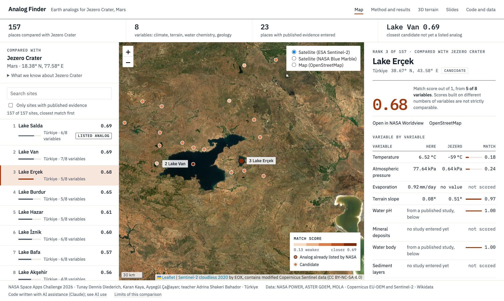

# Twin Shores

Where on Earth does Mars's Jezero Crater have a twin? A NASA Space Apps
Challenge 2026 project that scores lakes against Jezero with NASA and ESA data
and published studies, and shows why each one matches.

**Challenge:** Identify Earth Locations that Analog the Permanent Moon Base
Locations and Mars ·
**Team:** Team Physics, Türkiye (Universal Event)

**Live site:** https://2naydennis.github.io/Twin-Shores/ ·
**Lake Salda vs Jezero:** https://2naydennis.github.io/Twin-Shores/web/salda.html ·
**3D terrain:** https://2naydennis.github.io/Twin-Shores/web/rover.html ·
**Demo slides:** https://2naydennis.github.io/Twin-Shores/demo/slides.pdf ·
**Sources and credits:** https://2naydennis.github.io/Twin-Shores/web/sources.html

## Run it yourself

Everything runs with Python 3 and a web browser; no installs are needed for
the data pipeline or the website.

Open the website locally (from the repo root), then visit
http://localhost:8000/web/ :

```bash
python3 -m http.server 8000
```

Re-run the analysis, in this order:

```bash
python3 pipeline/fetch_nasa.py        # NASA POWER, MOLA and SRTM samples into data/nasa/
python3 pipeline/score.py             # scores every candidate against Jezero into data/analogs.json
python3 pipeline/sensitivity.py       # random-weights, leave-one-out and equal-evidence tests
python3 pipeline/crosscheck_slope.py  # slope re-measured with Copernicus EU-DEM
python3 pipeline/site_cards.py        # field-test cards and the Salda vs Jezero profiles
python3 pipeline/salda_study.py       # catchment, inlets, overflow point and lake-level curves for Salda and Jezero
```

`pipeline/find_lakes.py` re-imports the lake list from Wikidata. The 3D
terrain is rebuilt with `web/tools/build_terrain.py`, which needs numpy and
Pillow. The slides are rebuilt with `demo/build_slides.py` and exported to
PDF from a browser.

## Scope: Mars, not the Moon

The challenge covers both Moon base locations and Mars. This project covers
Mars only, and one target on it: Jezero Crater, the ancient lake Perseverance
is exploring.

The reason is the method. Our eight comparison variables describe a lake:
water chemistry, mineral deposits, sediments, evaporation. They fit Jezero's
former lake and have no counterpart on the Moon, which never had one. A Moon
search needs its own variables (permanent shadow, regolith, lava tubes, polar
cold). The scoring code takes any target and any variable list, so that is an
extension of the same tool, not a rewrite. We did not build it in the time
available and do not claim to.

## Results so far

70 places scored against Jezero: 38 lakes in Türkiye, 24 lakes in other
countries, and 8 known analog sites. Top of the ranking on 2026-11-14:

| Rank | Place | Score | Variables used | Status |
|------|-------|-------|----------------|--------|
| 1 | Lake Salda, Türkiye | 0.741 | 7 of 8 | known analog (NASA) |
| 2 | Lake Van, Türkiye | 0.693 | 7 of 8 | candidate |
| 3 | Lake Alchichica, Mexico | 0.689 | 7 of 8 | candidate |
| 4 | Lake Erçek, Türkiye | 0.687 | 5 of 8 | candidate |
| 5 | Mono Lake, USA | 0.657 | 6 of 8 | candidate |
| 6 | Lake Burdur, Türkiye | 0.655 | 5 of 8 | candidate |

**How the list of places was chosen.** The search first covered all 148
natural lakes in Türkiye that Wikidata lists. On 2026-11-14 the team narrowed
it: 111 Turkish lakes with no published evidence entered and more than 150 km
from Lake Salda were removed, and 24 lakes from other countries were added
(carbonate and microbialite lakes, impact-crater lakes, soda lakes, and five
well-known large lakes expected to be poor analogs). Each measured variable is
scaled by its spread across all places, so changing the list shifts every
score a little. The evidence for the added lakes was proposed by an AI tool
from search summaries and still needs the team's check. The removed lakes are
in the git history of `pipeline/config.json`.

Three checks on this ranking (details in
[pipeline/README.md](pipeline/README.md)):

- **Weights.** With the eight weights redrawn at random 5,000 times, Lake
  Salda stays in the top five in 99% of draws, Lake Erçek in 92%, Lake Van in
  83%, Lake Alchichica in 65%, and Mono Lake and Lake Burdur in 48% each.
- **Single variables.** Removing any one variable leaves Salda, Van and Erçek
  in the top five every time, and Alchichica in six of the eight cases.
- **Second elevation model.** Slope was measured again with the Copernicus
  EU-DEM (European Union and ESA) and compared with the NASA/METI ASTER
  values used in the scores.

How to read it, and what it does not show, is in
[pipeline/README.md](pipeline/README.md). In short: places are scored on
different numbers of variables, the literature-based matches are proposals
awaiting the team's check, and no place on Earth matches Mars's air pressure.

## What is in the project

| Part | What it does | Where |
|------|--------------|-------|
| Map | 70 places ranked against Jezero, with every variable and its source | [web/](https://2naydennis.github.io/Twin-Shores/web/) |
| Lake Salda page | Salda beside Jezero: orbit views, basin shape, evidence, field-test plan | [web/salda.html](https://2naydennis.github.io/Twin-Shores/web/salda.html) |
| Method and results | Scoring rule, live weight sliders, robustness tests, limits | [web/method.html](https://2naydennis.github.io/Twin-Shores/web/method.html) |
| Salda study | Scientific report, comparative basin map and assessment of what Salda can and cannot teach about Jezero | [web/study.html](https://2naydennis.github.io/Twin-Shores/web/study.html) |
| 3D terrain | Drive Salda, Van and Erçek, and Jezero on NASA elevation data; two labelled simulations | [web/rover.html](https://2naydennis.github.io/Twin-Shores/web/rover.html) |
| Sources and credits | Every dataset, library, study and image, and how AI tools were used | [web/sources.html](https://2naydennis.github.io/Twin-Shores/web/sources.html) |
| Pipeline | Python scripts that fetch NASA and ESA data, score places and test the ranking | `pipeline/` |
| Data | Scores, robustness results, field cards. `data/analogs.json` is the one file the pipeline writes and the website reads; its shape is in [data/SCHEMA.md](data/SCHEMA.md) | `data/` |
| Slides | The 7-slide demo | `demo/slides.pdf` |



## Two caveats that apply everywhere

- Salda is an analog for the ancient lake and carbonate setting at Jezero, not
  for Mars as a whole.
- Salda today and Jezero 3.5 billion years ago are different time frames. No
  place on Earth reproduces Mars's gravity, pressure or radiation.

## Team

Team Physics, Türkiye, NASA Space Apps Challenge 2026 (Universal Event):
Tunay Dennis Diederich, Karan Kaya, Adrina Shakeri Bahador; teacher Ayşegül
Çağlayan.

## AI use

Space Apps requires AI-generated code and data to be acknowledged in text and
metadata. Add a line here every time an AI tool produces something that stays
in the project.

| Date       | Tool                         | What it produced or did                                   |
|------------|------------------------------|-----------------------------------------------------------|
| 2026-11-14 | Claude (Anthropic, Claude Code) | Repo scaffold: this README, `SUBMISSION.md`, `data/SCHEMA.md`, `.gitignore`, folder READMEs |
| 2026-11-14 | Claude (Anthropic, Claude Code) | `data/analogs.json` mock data (placeholder values, not real scores) |
| 2026-11-14 | Claude (Anthropic, Claude Code) | Suggested project structure, work split, and a first outline of the approach |
| 2026-11-14 | ChatGPT (OpenAI)             | Background reading on Lake Salda and Jezero Crater         |
| 2026-11-14 | Claude (Anthropic, Claude Code) | Found and link-checked the candidate NASA datasets in `SUBMISSION.md`; tested the NASA POWER request in `pipeline/README.md` |
| 2026-11-14 | Claude (Anthropic, Claude Code) | Wrote `pipeline/fetch_nasa.py` and ran it. The files in `data/nasa/` are NASA data fetched by that script, not AI-generated values. Site and target coordinates in the script were entered by the AI from memory and need checking |
| 2026-11-14 | Claude (Anthropic, Claude Code) | Wrote `pipeline/score.py` and the layout of `pipeline/config.json`, and ran the first scoring. The eight comparison variables were chosen by the team (from a list drafted earlier with ChatGPT). The scoring formula, the split into measured and judged variables, and the placeholder weights of 1 came from the AI and need the team's review |
| 2026-11-14 | Claude (Anthropic, Claude Code) | Wrote `pipeline/find_lakes.py` and ran it and the scoring over 157 places. Searching Türkiye's lakes was the team's choice; taking the full Wikidata list was the AI's suggestion |
| 2026-11-14 | Claude (Anthropic, Claude Code) | Web research on the 15 top-ranked lakes and the judged matches entered in `pipeline/config.json` for six of them, each marked `proposed_by` AI with its source. The rubric for judged variables was written by the AI. The team must check the sources and confirm or change every match |
| 2026-11-14 | Claude (Anthropic, Claude Code) | Web research and proposed matches for eight more lakes (salty and alkaline lakes outside the top 15); the "Scope" and "Results so far" text above; draft answers in `SUBMISSION.md`; the slide deck in `demo/` and the script that builds it. All drafts are for the team to rewrite in their own words |
| 2026-11-14 | Claude (Anthropic, Claude Code), in Kranimo's session | The website in `web/`: the map page (`index.html`, `map/app.js`, `map/style.css`), the rover drive (`rover.html`, the files in `rover/`) and `web/tools/build_terrain.py`. The terrain heightmaps are NASA data fetched by that script. Details in `web/README.md` |
| 2026-11-14 | Claude (Anthropic, Claude Code) | `pipeline/sensitivity.py` and `pipeline/crosscheck_slope.py` and their output files; web research and proposed matches for a third round of 20 lakes (evidence found for 8) |
| 2026-11-14 | Claude (Anthropic, Claude Code) | Redesign of the map page and a new method and results page: `web/index.html`, `web/method.html`, `web/map/app.js`, `web/map/method.js`, `web/map/style.css`, `web/favicon.svg`. The method page text is an AI draft |
| 2026-11-14 | Claude (Anthropic, Claude Code) | Restyle of the 3D terrain page (`web/rover.html`) and toned-down markers and wording in `web/rover/game.js` and `web/rover/main.js` |
| 2026-11-14 | Claude (Anthropic, Claude Code) | More detailed 3D scene: survey boat model, rover detail and materials, `web/rover/scenery.js` (sky, ripples, rocks, pines), shadows and reflections; Salda heightmap rebuilt at 513 x 513 from SRTM by `web/tools/build_terrain.py` |
| 2026-11-14 | Claude (Anthropic, Claude Code) | Lake Van and Lake Erçek map in the 3D page (terrain built by `web/tools/build_terrain.py` from SRTM), three-way site menu, Graphics High/Low setting, phone layout of the 3D page, per-minute script version stamp on all pages |
| 2026-11-14 | Claude (Anthropic, Claude Code) | Slides rebuilt with website screenshots, a robustness chart and 3D views. A draft video was made and then removed at the team's request; the slides are the demo |
| 2026-11-14 | Claude (Anthropic, Claude Code) | `pipeline/site_cards.py` and its outputs (`data/site_cards.json`, `data/twin_salda.json`); the featured-site page, first for Lake Erçek and then, at the team's request, for Lake Salda (`web/salda.html`, `web/map/twin.js`); weight sliders on the method page; the not-yet-checked list, how-to line and share images; slides reworded to feature Lake Salda. Test suggestions are fixed rules written by the AI |
| 2026-11-14 | Claude (Anthropic, Claude Code) | Lake Salda pH evidence (measured pH 9.08 to 9.52, two studies) entered and scores re-run; featured page switched from Lake Erçek to Lake Salda at the team's request |
| 2026-11-14 | Claude (Anthropic, Claude Code) | Project renamed Twin Shores (name chosen by the team from suggestions by Claude); form answers in `SUBMISSION.md` and the slide text rewritten by Claude at the team's request |
| 2026-11-14 | Claude (Anthropic, Claude Code), in Kranimo's session | Additions to the 3D page: evidence points read from `data/analogs.json` (`web/rover/game.js`); the ancient-Jezero view, a simulated lake filled to -2,430 m on the MOLA terrain with invented microbial mounds, labelled as a simulation; a minimap (`web/rover/minimap.js`); and a falling-lake scenario for Lake Salda, labelled as a scenario and not a forecast, on an assumed lake bed. The ideas for these views were the team's; the water levels, the assumed lake bed and the wording of the notices came from the AI and need the team's review |
| 2026-11-14 | Claude (Anthropic, Claude Code), in Kranimo's session | Candidate list narrowed to 70 places at the team's request: 111 lakes in Türkiye with no evidence entered and more than 150 km from Lake Salda removed, 24 lakes from other countries added with coordinates from Wikidata. The removal rule and the four groups of lakes were the team's choice from options the AI proposed; the individual lakes were picked by the AI. Evidence for 17 of the new lakes was proposed by the AI from search summaries, each marked `proposed_by` AI and "full text not opened". `pipeline/site_cards.py` changed to look up airports and towns near sites outside Türkiye; scoring, sensitivity tests, site cards and slope cross-check re-run |
| 2026-11-15 | Claude (Anthropic, Claude Code), in Kranimo's session | The Salda study page asked for by the team's teacher (`web/study.html`, `web/map/study.js`): a scientific report, a comparative map and an assessment. `pipeline/salda_study.py` and its output `data/salda_study.json` (catchment, stream inlets, overflow point, lake-level curves and slope classes for Salda and Jezero, computed from the SRTM and MOLA heightmaps). The report text and the assessment in `data/salda_report.json` were drafted by the AI from sources it opened and read, each statement labelled by how it is known; the "support" levels and the suggested fieldwork are the AI's proposals for the team to judge |
| 2026-11-15 | Claude (Anthropic, Claude Code), in Kranimo's session | Source check: the AI opened the sources behind the judged entries that had only been seen as search summaries, and recorded the result in each entry's `checked` field in `pipeline/config.json` (40 of 73 now read and supported, 12 opened but not confirmed, 21 still unread). Three entries were corrected from their sources; no match value, score or rank changed. The study page's sources were re-marked the same way |
| 2026-11-15 | Claude (Anthropic, Claude Code) | Sources and credits page (`web/sources.html`, `web/map/sources.js`), asked for by the team: NASA, ESA and other data, libraries, images and AI use, with the study list built from `data/analogs.json` and `data/salda_report.json`. "Start here" bar on the map page and a Sources link in every page menu. Page text is an AI draft for the team to check |
| 2026-11-15 | Claude (Anthropic, Claude Code) | Fix on the 3D page: in the ancient-Jezero view the evidence cards now describe the ancient lake instead of Mars today (`web/rover/game.js`, `web/rover/main.js`). The five ancient-era texts were written by the AI from NASA pages it opened (Perseverance lake history, MAVEN) and need the team's check |
| 2026-11-15 | Claude (Anthropic, Claude Code) | Repository cleanup for judging, at the team's request: `SUBMISSION.md` (working notes and draft form answers) and six unused screenshots moved out of the public repo; the unused Moon targets and LOLA download removed from `pipeline/fetch_nasa.py` and `data/nasa/target_elevation.json`; `web/README.md` and `pipeline/README.md` rewritten; this README tidied; the AI-drawn site icon disclosed on the Sources and method pages |

Commits made with AI help carry a `Co-Authored-By` line in the commit message.

## Data sources

Full list with links and licences: [Sources and credits](https://2naydennis.github.io/Twin-Shores/web/sources.html) on the website.

In use (fetched by `pipeline/fetch_nasa.py`, stored in `data/nasa/`):

- NASA POWER climatology API: climate for 8 Earth sites
- Mars Global Surveyor MOLA MEGDR (NASA PDS Geosciences Node): Mars target
  elevations, Jezero terrain profile
- NASA SRTM 1 arc second, tile N37E029, downloaded from AWS Terrain Tiles:
  Lake Salda terrain profile
- NASA Planetary Analog Explorer: starting list of sites and targets
- NASA/METI ASTER GDEM, through the OpenTopoData API: slope at each Earth
  candidate
- NSSDCA Mars Fact Sheet: Mars temperature and pressure
- Copernicus EU-DEM (European Union and ESA), through the OpenTopoData API:
  second slope measurement (`pipeline/crosscheck_slope.py`)
- Wikidata: the list of lakes and their coordinates (`pipeline/find_lakes.py`)

In use by the website (`web/`):

- NASA SRTM tiles N37E029 and N38E043 and MGS MOLA MEGDR MEGT44N000HB: 3D terrain
- NASA Mars Trek tiles (MOLA shaded relief, MRO CTX mosaic of Jezero): Jezero map on the Salda page
- NASA GIBS Blue Marble: optional base map
- ESA Copernicus Sentinel-2 cloudless (EOX): default satellite base map
- OpenStreetMap: alternative base map tiles
- Leaflet 1.9.4 and three.js 0.160.0: map and 3D libraries
